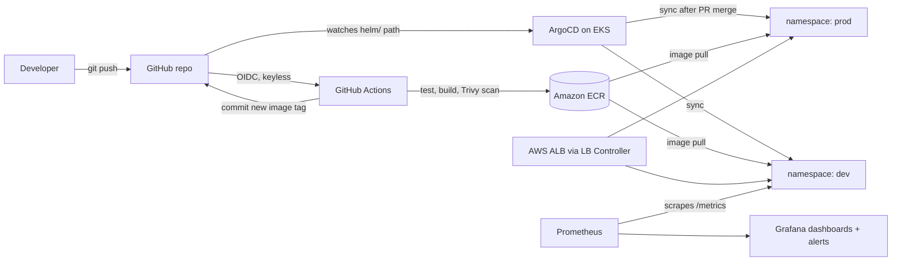

# GitOps Platform on AWS EKS (Terraform + ArgoCD + GitHub Actions)

A production-style Kubernetes platform where **infrastructure and application deployments are driven entirely from Git**: no manual `kubectl apply`, no AWS keys stored in GitHub, and full observability out of the box.

> **Outcome:** `git push` → tests → image scan → ECR → Git commit of the new tag → ArgoCD syncs to EKS in minutes. Production promotion happens through a reviewed pull request.

## Architecture



## Tech stack

| Area | Tools |
|---|---|
| IaC | Terraform (modular community modules), S3 + DynamoDB remote state |
| Compute | AWS EKS (managed node group, Spot optional), VPC with public/private subnets |
| CI | GitHub Actions, **AWS OIDC (no static credentials)**, Trivy image scanning |
| CD | ArgoCD (auto-sync, self-heal, prune), Helm |
| Ingress | AWS Load Balancer Controller (ALB) with IRSA |
| Observability | kube-prometheus-stack (Prometheus, Alertmanager, Grafana), ServiceMonitors, PrometheusRule alerts, custom dashboard |
| Apps | Two Python/Flask microservices (`catalog`, `orders`) exposing Prometheus metrics |

## Repository layout

```
.
├── app/                 # catalog + orders services (Dockerfile, tests)
├── helm/microservices/  # one chart, per-environment values (dev / prod)
├── argocd/              # ArgoCD Application manifests
├── monitoring/          # Grafana dashboard ConfigMap
├── terraform/           # VPC, EKS, ECR, IRSA, GitHub OIDC, Helm add-ons
│   └── bootstrap/       # one-time remote-state bucket + lock table
└── .github/workflows/   # ci, promote-prod, terraform-validate
```

## Prerequisites

AWS account + CLI configured, Terraform >= 1.6, kubectl, Helm, Git, a GitHub account.

## Deploy

**1. Replace placeholders.** In `argocd/app-dev.yaml` and `argocd/app-prod.yaml` set `repoURL` to your repo. Copy `terraform/terraform.tfvars.example` to `terraform/terraform.tfvars` and set `github_org`.

**2. Bootstrap remote state (once).**
```bash
cd terraform/bootstrap
terraform init && terraform apply -var="state_bucket_name=<globally-unique-name>"
```

**3. Create the platform.**
```bash
cd ..   # terraform/
cp backend.hcl.example backend.hcl      # edit bucket name
terraform init -backend-config=backend.hcl
terraform apply                         # ~15-20 min
$(terraform output -raw kubeconfig_command)
```

**4. Wire up GitHub.** Add the output `github_actions_role_arn` as repository secret **`AWS_ROLE_ARN`**. Under *Settings > Actions > General*, set workflow permissions to *Read and write*.

**5. Register the apps with ArgoCD and load the dashboard.**
```bash
kubectl apply -f argocd/app-dev.yaml -f argocd/app-prod.yaml
kubectl apply -f monitoring/microservices-dashboard.yaml
```

**6. Ship a change.** Edit anything under `app/`, push to `main`, and watch the pipeline run. ArgoCD deploys the new tag to `dev`. To release to production run the **promote-to-prod** workflow with the tag and merge the PR it opens.

## Access

```bash
# ArgoCD UI (admin password)
kubectl -n argocd get secret argocd-initial-admin-secret -o jsonpath="{.data.password}" | base64 -d
kubectl -n argocd port-forward svc/argocd-server 8080:443

# Grafana
terraform output -raw grafana_admin_password
kubectl -n monitoring port-forward svc/kube-prometheus-stack-grafana 3000:80

# App endpoint
kubectl -n dev get ingress microservices
curl http://<alb-dns>/catalog/products
curl -X POST http://<alb-dns>/orders -H 'Content-Type: application/json' -d '{"product_id":1,"quantity":2}'
```

## Key design decisions

- **Keyless CI:** GitHub OIDC trusts only `repo:<org>/<repo>:ref:refs/heads/main`; the role can push to the three ECR repos and nothing else.
- **Immutable image tags** (git SHA) so every deployment is traceable and rollbacks are a `git revert`.
- **Git is the only deployment interface:** ArgoCD `selfHeal` reverts manual cluster drift.
- **Production gate = pull request review**, not a separate tool.
- **Cost controls:** single NAT gateway, Spot nodes, ECR lifecycle policy, `force_delete` for clean teardown.
- **Hardened pods:** non-root, read-only root filesystem, no privilege escalation, resource limits, probes.

## Cost and cleanup

EKS control plane (~$0.10/h) + NAT gateway + 2 nodes + ALB is roughly **$5-6/day**. Not free tier, so destroy when done:

```bash
kubectl delete -f argocd/ ; sleep 60          # lets the controller remove the ALBs
cd terraform && terraform destroy
```
Set an AWS Budget alert before you start.

## Screenshots to add (put in `docs/`)

ArgoCD app tree (synced/healthy), GitHub Actions green run, Grafana dashboard, `kubectl get pods -A`.

## What I learned

- Wiring IRSA and OIDC so no long-lived credentials exist anywhere.
- Why ArgoCD needs the CRDs (ServiceMonitor) installed before the app syncs, and how Terraform ordering solves it.
- Debugging ALB target health (`/health` probes, `target-type: ip`).
- Designing a promotion flow that keeps production changes reviewable.

## Resume bullet

> Designed and deployed a GitOps-based EKS platform using Terraform and ArgoCD; zero-touch rollouts in under 5 minutes, keyless GitHub Actions authentication via AWS OIDC, Trivy-gated images, and Prometheus/Grafana observability with alerting.
